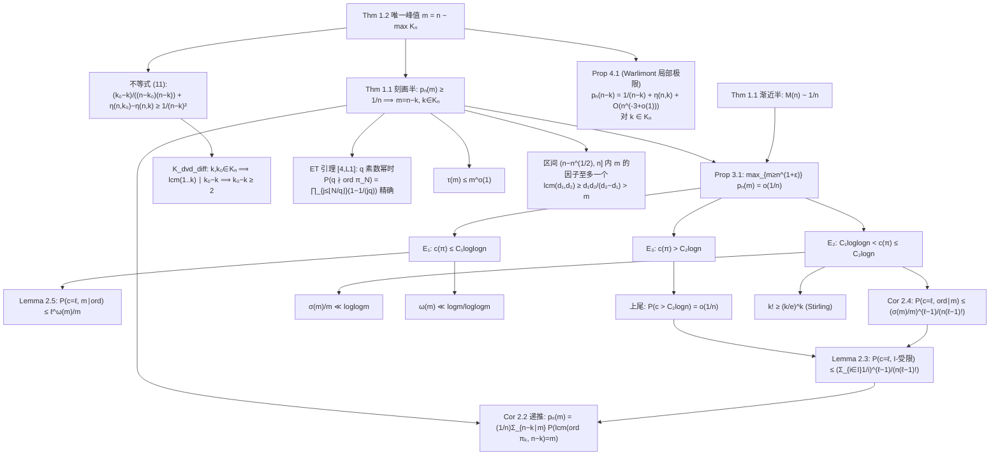

# 证明路线图 / 思维导图 — The most probable order of a random permutation

Adrian Beker, arXiv:2510.11698v1 (Oct 2025)。形式化项目：`most_probable_order`。

## 1. 论文主定理

- **Thm 1.1**：`M(n) := max_m pₙ(m) ~ 1/n`；且 n 充分大时，`pₙ(m) ≥ 1/n ⟹ m = n−k, k ∈ Kₙ`，
  其中 `Kₙ = {k < n : lcm(1,…,k) ∣ n−k}`（`Kₙ ∋ 0,1`）。
- **Thm 1.2**：n 充分大时，`pₙ(m) = M(n) ⟺ m = n − max Kₙ`（分布的唯一峰值）。

## 2. 证明思维导图

## 3. 论文各部分 → Lean 模块映射

| 论文条目 | 内容 | Lean 模块 | 状态 |
|---|---|---|---|
| §1 定义 | pₙ(m), M(n), Kₙ | `Basic` | ✅ |
| (2) | M(n) ≥ pₙ(n) ≥ 1/n | `Basic` (`one_div_le_p_self`) | ✅ |
| Fact 2.1 | ord = lcm(圈长) | `Basic` (`order_eq_lcm_cycleType`) | ✅ |
| Cor 2.2 | 首步条件化递推 + P(ord∣m) ≤ τ(m)/n | `Perm/Decompose` (`ord_dvd_prob_le_tau_div_n`) + `Perm/Recursion` (`p_eq_sum_recursion`) | ✅ |
| Lemma 2.3 | I-受限圈数局部界 | `Perm/RestrictedBound` (`prob_numCycles_IsRestricted_le`) | ✅ |
| Cor 2.4 | I=divisors(m) 情形 | `Perm/RestrictedBound` (`prob_numCycles_orderOf_dvd_le`) | ✅ |
| Lemma 2.5 | P(c=ℓ, m∣ord) ≤ ℓ^ω(m)/m | `Perm/CyclesAndPrimes` (`cyclesAndPrimes_prob_le`) | ✅ |
| Prop 3.1 | m ≥ n^{1+ε} 的质量 o(1/n) | `Perm/LargeOrders` + `Perm/LargeOrdersAsymptotic` (`prop_large_orders`, ε=1/2) + `Perm/LargeOrders43` (`prop_large_orders_43`, ε=1/3) | ✅ |
| Thm 1.1 | M(n)~1/n + 刻画 | `Perm/Theorem11` (`p_ge_one_div_n_implies_mem_K` + `tendsto_n_mul_M_one`) | ✅ |
| Prop 4.1 | Warlimont 局部极限 + η 项 | `Perm/Warlimont` (`prop_exact_order`) | ✅（Tᵢ 分解全链零 sorry） |
| Thm 1.2 | 唯一峰值 | `Perm/Warlimont` (`theorem_equality_case`) | ✅（依赖 Prop 4.1 + Theorem 1.1 表征） |
| Remark | M(n) = 1/n + O(log n/n²) | `Perm/Warlimont` (`M_sub_one_div_le_log`) | ✅（k₀≤2log₂n+1 经二项式下界 `Chebyshev.two_pow_le_mul_lcmUpto`） |

外部依赖（mathlib v4.30.0 无、需自建）：
- τ/σ/ω 增长界（Tenenbaum I.5 定理 3/5 的初等版）→ `Arithmetic/DivisorBounds` ✅
- Euler Σ_{p≤x}1/p ≤ loglogx + O(1) → `Arithmetic/DivisorBounds` ✅（Mertens 第一定理自证）
- ET 精确乘积（Erdős–Turán 1967 II, Lemma 1）→ `Perm/ErdosTuran` ✅（自证）
- Warlimont 1978 方法的适配 → `Perm/Warlimont` `prop_exact_order` ✅（Tᵢ 分解，零 sorry）
- max Kₙ ≪ log n（论文用 PNT）→ 初等替代：二项式下界 `Chebyshev.two_pow_le_mul_lcmUpto` ✅

## 4. 关键证明洞察（形式化路线备注）

1. **Lemma 2.3 的平均化论证**：轮型求和重排为有序元组后，恒等式
   `(n/ℓ)·∏_j 1/i_j = (1/ℓ)·Σ_j ∏_{t≠j} 1/i_t`（因 n = Σ i_j），右端每个 (ℓ−1) 元组取值于
   I∩[1,n−1]，放缩即得界。等号情形：n=4, I={2}, ℓ=2（已数值验证）。
2. **ET 精确乘积**：经含 1 圈递推 f(N) = (1/N)Σ_{q∤d}f(N−d) + 强归纳，辅助恒等式
   Σ_{k≤K} C(1/q,k)(−1)^k = ∏_{j≤K}(1−1/(jq))（下降阶乘部分和）。仅对素数幂 q 成立
   （q=6,n=6 数值反例已验证公式不成立）。
3. **Prop 4.1 的 η 项**（本形式化的最深洞察，已完整数值验证）：
   - k∈Kₙ ⟹ ν₂(n−k) ≥ ⌊log₂k⌋（lcm(1..k) ∣ n−k）；
   - 特异项要求小因子 d ≤ k ⟹ 2^{ν₂(n−k)} ≤ k ⟹ **ν₂(n−k) = ⌊log₂k⌋**，
     特异小因子唯一 = 2^{⌊log₂k⌋}（奇部分必为 1）；
   - 其余小因子自动为 [1, k−2^v] 全体（Kₙ 保证整除 n−k）；
   - 额外构型求和经"轮型单位分解"恒等式
     `Σ_{m+Σd·m_d=K} 1/m!·∏1/(m_d! d^{m_d}) = 1`（= [z^K]1/(1−z)，即 Σ_μ #perms(μ)/K! = 1）
     精确配平为 `2^{1−⌊log₂k⌋}/(n−k)²`；
   - 主项 1/(n−k) 精确：含 (n−k)-圈的置换，其余 k 点任意置换的阶 ∣ lcm(1..k) ∣ n−k。
4. **σ(m)/m ≪ loglogm 链**：σ/m ≤ m/φ(m)；−log(1−1/p) ≤ 1/p + 1/p²；
   Σ_{p∣m}1/p ≤ loglog p_r + B（Euler 上界）；p_r ≤ log m/c₀（Chebyshev θ 下界，mathlib 有）。
   注意逐项常数必须为 1（2 则退化为 (loglogm)²，E₂ 估计会失败）。
5. **ω(m) 界**：m ≥ (r+1)! ≥ (r/e)^r（Stirling 下界，mathlib 有）+ 分段（r ≤ √logm 平凡；否则
   log r ≥ ½loglogm）。

## 5. 数值锚定测试（Warlimont 动工前必做）

- **T2（最高优先级）**：n ≤ 8、全体 k ∈ Kₙ，暴力枚举 S_n 算 p n (n−k)，对照 1/(n−k)+η(n,k)。
- **T3**：ET 乘积 ℚ 精确相等（n=8, q=4 等）。
- **T5**：Cor 2.2 递推 n≤6 双边精确相等。
